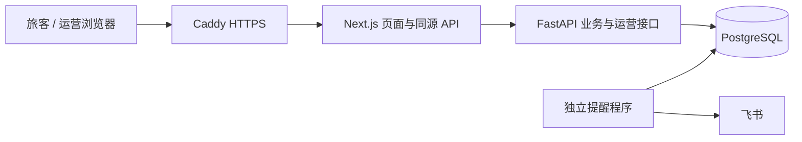

# AI Travel Ops Copilot · 入境游产品与咨询网站

[在线网站](https://gengchenxuan.space) · [架构](docs/architecture.md) · [运行与验证](docs/setup.md) · [公开范围](docs/publication.md)

基于入境游业务经验，在实习后借助 AI 编程工具开发的全栈项目。将产品资料、路线选择、预算估算和人工咨询衔接起来：旅客先了解产品与服务范围，运营再获得带方案和报价上下文的咨询。

**现行网站采用确定性业务规则，不调用 LLM，也没有 RAG 或自主 Agent。** 项目名称保留早期 AI 探索历史。旧自由文本需求抽取、Streamlit/CLI 与上海半定制程序已于 2026-10-12 移除，不是当前功能。

## 已经交付什么

- 英文旅客网站：10 个目的地、21 个标准产品；选择实际天数、人数、互斥路线和可选体验，查看逐日行程及团组销售估算。
- 两类咨询：产品方案咨询与独立偏好表单；服务端签名验证、报价复核、重复提交去重，提交事务成功后返回 `TC-` 编号。
- 运营与提醒：受保护的 `/ops` 查询与状态跟进、操作者历史及版本冲突检查；咨询和提醒任务同事务入库，独立程序发送飞书提醒。
- 数据与发布：PostgreSQL、成本版本和审计、报价快照；AWS EC2 新加坡、Docker Compose、Caddy HTTPS、备份与独立恢复工具。

估算目前不含住宿，最终金额和可用性需要人工确认；咨询成功不代表预订。没有订单、支付或自动邮件。价格为服务成本按规则加价，30% 加价不等于 30% 毛利率。

## 网站与这个公开仓库

| 范围 | 在线网站 | 公开源码副本 |
|---|---|---|
| 业务程序 | 2026-10-14 部署及限定场景验收的现行网站 | 从当前本地实现导出的应用、迁移和测试；无旧 Git 历史 |
| 数据 | 业务维护的 PostgreSQL 主数据 | 合成价格、演示产品文案及测试夹具；不代表市场价格或供应商报价 |
| 图片 | 线上业务素材 | 新绘制的 SVG 占位插图，故视觉与线上有差别 |
| 客户与运营 | 私有记录及独立凭据 | 不包含客户、付款、生产配置、飞书 webhook 或备份；运行者自行配置 |

公开副本中的演示服务保留代码引用与公开地点名称，以展示路线互斥、计价范围和一致性机制；金额由固定演示算法生成。不要把公开数据导入线上业务数据库。副本不是生产数据备份。

## 技术架构



- **前端：**Next.js App Router、React、JavaScript/JSX、普通 CSS、animejs。
- **后端：**FastAPI / Pydantic；产品匹配、服务计费、签名、幂等与事务。
- **数据库：**PostgreSQL 16、NUMERIC 金额、版本化迁移、分用途受限账户。
- **交付：**Docker Compose、Caddy、AWS EC2。前端密钥只在服务端读取。

主要取舍：金额由服务端重算；展示价格和提交时复核价格分别保留；状态更新不覆盖客户原始快照；数据库故障不回退旧文件金额；外部提醒失败不影响咨询保存。代码索引见 [架构](docs/architecture.md)。

## 运行与检查

需要 Python 3.11+、Node.js 22 和 npm；完整咨询存储需 PostgreSQL 16 或 Docker。以下从仓库根目录执行：

```bash
python3 -m venv .venv
.venv/bin/python -m pip install -r backend/requirements-dev.txt
.venv/bin/python -B scripts/verify_project.py
cd frontend
npm ci
npm run lint
npm run build
```

本地浏览、环境变量和数据库配置见 [运行说明](docs/setup.md)。文件模式可浏览与估算，未配置数据库时咨询提交会返回不可用，不会假装已保存。静态测试通过不代表已完成 PostgreSQL 或线上验收。

## 验证证据与能力边界

- **2026-10-14 线上历史验收：**两类虚构咨询及重复请求、状态版本冲突、飞书实际收件、20 张表独立恢复与重启摘要一致。公开摘要见 [验证记录](docs/validation.md)。
- **2026-11-01 公开副本：**重新验证合成数据、产品/报价/表单/运营规则、前端 lint 和生产构建；具体结果与未运行范围见同一记录。
- **早期 AI 历史：**曾对 LLM 需求结构化抽取做 50 条固定样例、270 个字段断言的提示词比较，75.93% → 97.78%；相关程序已退出本版本。这不是线上准确率或现行 Agent 能力。

没有实测营收、转化率、节省工时或高并发数据。项目由本人推动业务范围、规则核对与验收，AI 辅助代码、排障和文档，不声称所有代码独立手写。

## 目录

```text
backend/app/    FastAPI、领域规则、存储和 SQL 迁移
frontend/       页面、同源接口、演示内容和原创占位图
data/products/ 合成演示产品、服务与计价配置
scripts/        归一化、导出、维护和校验
tests/         文件模式与显式选择的数据库测试
deploy/         通用容器、配置和备份工具
docs/           架构、配置、验证和公开范围
```

本仓库不包含旧业务历史、私人参考资料和部署地址。旧仓库是历史入口，不应用来判断当前功能。公开边界和素材说明见 [publication.md](docs/publication.md)。
